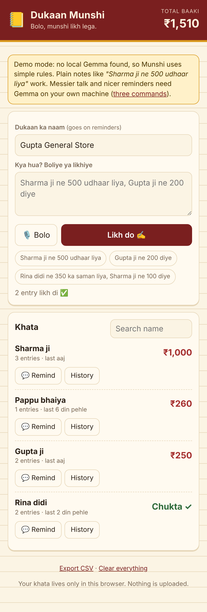

# Dukaan Munshi 📒

**Bolo, munshi likh lega.** A private *khata* (credit ledger) for small shops. Say what happened in Hindi, Hinglish or English ("Sharma ji ne 500 udhaar liya, Gupta ji ne 200 diye") and a **Gemma** model running on the shop's own machine turns it into ledger entries, keeps each customer's balance, and writes a polite WhatsApp reminder for anyone who owes money.

**Try it with nothing installed:** the [live demo](https://abhyudaysharma.github.io/Dukaan-Munshi/) works in demo mode (simple rules instead of Gemma). Press "demo khata" to load made-up customers.



## Why a shop would pay for it
Every kirana shop runs on udhaar, and the khata is usually a paper notebook or someone's memory. Chasing money is the awkward part. Munshi does the writing and the wording, in the shopkeeper's language, and the customer list never leaves the shop.

## How it works
- **Capture:** type or speak (browser voice typing, `hi-IN`). Munshi shows what it understood **before** saving: fix the type, name or amount, then confirm. The model suggests, you decide.
- **Khata:** balances per customer (udhaar adds, jama subtracts, cash sales never touch a person). Delete any entry, export CSV.
- **Remind:** pick a tone (meethi, seedhi, mazaakiya) and language, edit the text, send on WhatsApp.
- **Guardrails:** the server drops entries with bad types, zero amounts or no name, strips markdown, and passes existing customer names to the model so "sharma" lands on "Sharma ji".
- **Demo mode:** no model? A small rule-based reader and message templates keep the app useful.

## Run it
You need [Node 18+](https://nodejs.org) and [Ollama](https://ollama.com). No `npm install`.
```bash
ollama pull gemma3:4b
git clone https://github.com/Abhyudaysharma/Dukaan-Munshi.git
cd Dukaan-Munshi && node server.js   # http://localhost:3000
```
Env: `PORT`, `OLLAMA_URL`, `MODEL`. Data stays in the browser's `localStorage`; the only network calls are to your own Ollama.

## Tests
`npm test` runs a fake Ollama and checks the rule reader, balances, templates, entry cleaning, the API and error paths.

## Publishing the demo
`.github/workflows/pages.yml` deploys `public/`. Settings → Pages → Source: GitHub Actions.

## License
MIT
